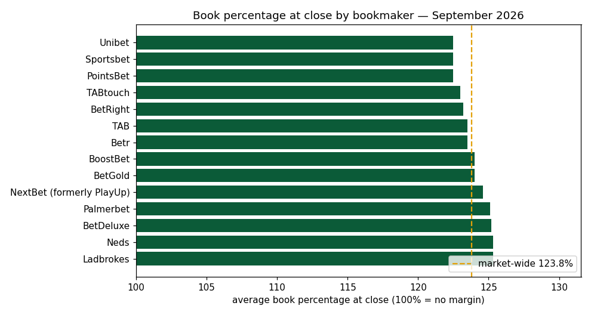
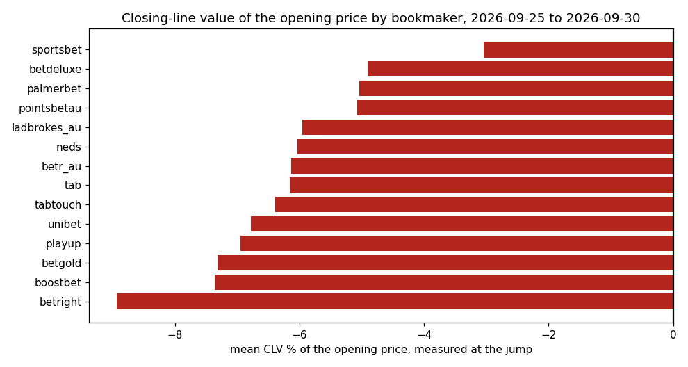

<picture>
  <source media="(prefers-color-scheme: dark)" srcset="docs/logo-dark.svg">
  
</picture>

# PuntersEdge API examples — Australian racing & sports odds in Python

Seven small, runnable scripts against the [PuntersEdge Odds API](https://puntersedge.online/api?utm_source=github_examples&utm_medium=cookbook_readme):
live win/place prices for Australian horse, greyhound and harness racing across
[14 bookmakers, measured live](https://puntersedge.online/coverage-report.json),
British and Irish racing bookmaker by bookmaker, plus head-to-head sports odds.

Each script is standalone — read it top to bottom, run it, adapt it. No framework,
no shared helpers, no magic.

## Run something in 30 seconds (no key needed)

```
git clone https://github.com/Propertyscout001/puntersedge-examples
cd puntersedge-examples
pip install -r requirements.txt
python examples/01_next_to_go.py
```

Without a key, scripts 01 and 06 hit the keyless demo sandbox (real data, truncated).
For the full feed, [grab a free key](https://puntersedge.online/api?utm_source=github_examples&utm_medium=cookbook_readme#signup)
— 3,000 credits/month, no card — and:

```
export PUNTERSEDGE_API_KEY=your_key_here
```

## The examples

| script | what it shows | endpoint | credits/call* |
|---|---|---|---|
| [01_next_to_go.py](examples/01_next_to_go.py) | upcoming races, favourite per race | `/v1/racing/next-to-go` | 2 |
| [02_best_odds_board.py](examples/02_best_odds_board.py) | best win/place price per runner across books | `/v1/racing/best-odds` | 3 |
| [03_movers.py](examples/03_movers.py) | firmers and drifters before the jump | `/v1/racing/movers` | 3 |
| [04_results_to_csv.py](examples/04_results_to_csv.py) | settled results → CSV | `/v1/racing/results` | 2 |
| [05_price_history_to_csv.py](examples/05_price_history_to_csv.py) | open/close/high/low per runner-book → CSV | `/v1/racing/price-history` | 5 |
| [06_sports_best_odds.py](examples/06_sports_best_odds.py) | best head-to-head price per team (NRL, AFL, …) | `/v1/best-odds/{sport}` | 3 |
| [07_uk_racing_card.py](examples/07_uk_racing_card.py) | British & Irish card per bookmaker in UK fractions, then results with SPs | `/v1/racing/next-to-go`, `/v1/racing/results` | 2 + 2 |
| [08_tip_tracker.py](examples/08_tip_tracker.py) | log a tip at the best price, then settle it against the closing price and the result: CLV and profit | `/v1/racing/next-to-go`, `/v1/racing/closing-lines` | 2–4 + 5 per tip |

\* measured against production on 2026-08-30 (07 on 2026-10-13). Your `/v1/usage` endpoint and the
`X-Credits-*` response headers always show the live numbers.

## British and Irish racing

[`07_uk_racing_card.py`](examples/07_uk_racing_card.py) prints the next British and Irish races in
London time with every runner's price at Ladbrokes / Coral, William Hill, Betway and the Australian
books that price UK racing, as a UK fraction wherever the decimal sits on the fractional ladder (the
API is decimal throughout). Then the last day's results with each runner's starting price. Standard
library only; it needs a free key. The [UK & Irish racing section](https://puntersedge.online/uk-racing-odds-api?utm_source=github_examples&utm_medium=cookbook_readme)
covers the closing-price archive and each bookmaker in more depth, and the
[Christmas racing page](https://puntersedge.online/uk-racing-odds-api/christmas-racing?utm_source=github_examples&utm_medium=cookbook_readme)
lists what a King George or Welsh National build needs.

```
PUNTERSEDGE_API_KEY=your_key python examples/07_uk_racing_card.py
```

## Notebook: a month of Australian racing closing lines

[`notebooks/closing-lines-clv.ipynb`](notebooks/closing-lines-clv.ipynb) walks the closing-line
archive end to end, with the outputs committed so it reads without a key:

1. the fixed [September 2026 edition](https://puntersedge.online/market-report/2026-09) of the
   market report (no key) — book percentage at the jump by bookmaker, best-price share,
   favourite strike rate by code;
2. a week of Australian thoroughbred closing lines pulled as CSV (Standard plan and above,
   20 credits for the call) — 27,108 rows across 264 races and 14 bookmakers in the committed run;
3. each bookmaker's best-price share and the open-to-close movement, recomputed locally with
   the report's own counting rule;
4. the closing-line value of every opening price, by bookmaker;
5. a call to `POST /v1/racing/clv` to score bets of your own (Plus and above — on a smaller
   plan the notebook shows the 403 and the upgrade link the API returns, which is what the
   committed run shows).




```
pip install -r requirements-notebook.txt
PUNTERSEDGE_API_KEY=your_key jupyter notebook notebooks/closing-lines-clv.ipynb
```

[Get a free key](https://puntersedge.online/api?utm_source=github_examples&utm_medium=notebook#signup)
(no card); the archive pull needs Standard. CLV measures a price against the market's final
view of a race, not against the result — nothing in the notebook is a betting strategy.

## Did your tips beat the closing price?

[`08_tip_tracker.py`](examples/08_tip_tracker.py) is a small tip tracker: log a runner at the best
price on offer (or the price you actually took), and after the race settle it against the best
closing price across the books and the finishing position.

```
export PUNTERSEDGE_API_KEY=your_key
python examples/08_tip_tracker.py next                  # next AU races, best price per runner
python examples/08_tip_tracker.py add RACE_ID 6         # log runner 6 at the best price now
python examples/08_tip_tracker.py settle                # after the race
```

```
Q Straight R12 Classic Boodie: took 3.20, closed 3.90 (CLV -17.9%), finished 1, profit +2.20 units

1 settled: 0 beat the closing price, profit +2.20 units
```

`next` and `add` work on the free tier; `settle` reads the closing-line archive, which is Standard
and above. [Get a free key](https://puntersedge.online/api?utm_source=demo&utm_medium=github&utm_campaign=tip-tracker#signup).
A winner taken under its closing price is still negative CLV: over many tips, CLV says more about
whether the prices you take are good than any single result does. It is a measuring tool, not a
betting strategy.

## Credit budgeting, honestly

The free tier is 3,000 credits/month. That is roughly **1,500 next-to-go calls** —
hourly polling all month with room to spare — but it is *not* enough for a
60-second live scanner (that's ~86,000 credits/month; the Standard plan's 75,000
credits at A$29/mo is built for that shape). Poll at the cadence your use case
actually needs, not the fastest one that works.

01 and 06 use only the Python standard library in demo mode, and 07 throughout; the keyed paths use the
official [`puntersedge` SDK](https://github.com/Propertyscout001/puntersedge-python)
(`pip install puntersedge`). 03–05 deliberately use plain `requests` so you can see
the raw REST calls — everything here ports directly to any language.

For arbitrage scanning specifically, don't reinvent it from these examples: the SDK
ships a `puntersedge.arb` toolkit with the freshness/coverage gates that make naive
scanners misfire, and a `puntersedge-arb` CLI.

## Notes

- Docs: [api.puntersedge.online/docs](https://api.puntersedge.online/docs) ·
  [OpenAPI](https://api.puntersedge.online/openapi.json)
- Coverage is measured, not promised: [coverage-report.json](https://puntersedge.online/coverage-report.json)
  is recomputed from the production ingest store over a trailing 7-day window.
- Odds data is for research and tooling. **Nothing here is betting advice, and no
  strategy shown is a claim that it makes money.**
- 18+. Gamble responsibly — in Australia: 1800 858 858, [gamblinghelponline.org.au](https://www.gamblinghelponline.org.au);
  in Great Britain: GamCare 0808 8020 133, [begambleaware.org](https://www.begambleaware.org); in Ireland: [gamblingcare.ie](https://www.gamblingcare.ie).

MIT licensed — use it in anything.
