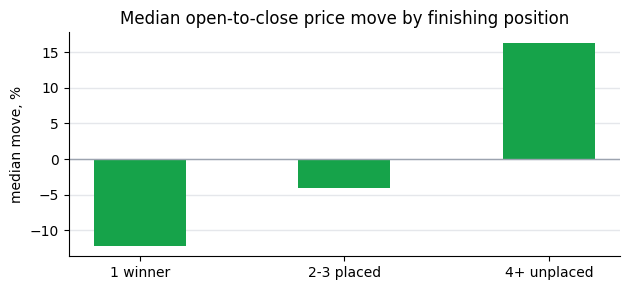

> **FIXTURE RUN.** This is `research.ipynb` executed with `PE_USE_FIXTURES=1` on the bundled synthetic
> fixtures: invented races and prices, not real data. It shows what each section prints; a live run
> prints the same tables for a real day.

# Racing research notebook: closing prices joined to results

One day of Australian racing from the PuntersEdge API: every bookmaker's first and last captured win
price for each runner, joined to the official result on the API's own race identifier, then
described. **Descriptive only.** Nothing here predicts a result or claims that any way of betting
makes money; a single day is a small sample.

* Set `PUNTERSEDGE_API_KEY` in your environment (or `.env` loaded by your shell), or run with
  `PE_USE_FIXTURES=1` to use the bundled **synthetic** fixtures (invented races, not real data).
* Plan: the closing-line archive is on Standard and above. On Free or Hobby the notebook says so and
  switches to a smaller sample every plan can read (recent results plus price history).
* Cost and limits: printed at the end. `PE_MAX_CALLS` caps the calls one run can make.

18+ only. Gambling Help: 1800 858 858, gamblinghelponline.org.au.


```python
import os
import pandas as pd
from pe_research import analysis, join, sample
from pe_research.client import ApiError, Client

DATE = os.environ.get("PE_SAMPLE_DATE") or sample.default_date()
COUNTRY = os.environ.get("PE_COUNTRY", "AU")
CATEGORY = os.environ.get("PE_CATEGORY", "horse") or None
key = os.environ.get("PUNTERSEDGE_API_KEY", "")
USE_FIXTURES = os.environ.get("PE_USE_FIXTURES") == "1" or not key or key == "replace-with-your-key"
client = None if USE_FIXTURES else Client(max_calls=int(os.environ.get("PE_MAX_CALLS", "40")))
print("Mode:", "FIXTURES (synthetic data, not real races)" if USE_FIXTURES else "live API",
      "| date", DATE, "| country", COUNTRY, "| category", CATEGORY or "all")
```

    Mode: FIXTURES (synthetic data, not real races) | date 2026-10-21 | country AU | category horse


## 1. What the archive covers

Read from the API (`/v1/racing/closing-lines/coverage`, `/v1/racing/results/coverage`, 1 credit each)
rather than typed here, because coverage moves every day.


```python
cov = sample.load_fixture("coverage.json") if USE_FIXTURES else sample.coverage(client)
print("Closing-line archive:", cov["closing_lines"].get("archive_from"), "to", cov["closing_lines"].get("archive_to"))
print("Results stored from: ", cov["results"].get("coverage_from") or cov["closing_lines"].get("results_from"))
cov
```

    Closing-line archive: 2026-08-04 to 2026-10-21
    Results stored from:  2026-08-15


    {'closing_lines': {'archive_from': '2026-08-04',
      'archive_to': '2026-10-21',
      'results_from': '2026-08-15'},
     'results': {'coverage_from': '2026-08-15'}}


## 2. The sample

`/v1/racing/closing-lines?date=` returns one row per runner per bookmaker with the opening and closing
win price (5 credits per page of up to 5,000 rows); scratched runners are included and flagged so the
join can name them. `/v1/racing/results?date=` returns the day's results, paged 200 at a time.


```python
PATH = "fixtures"
if USE_FIXTURES:
    prices, results = sample.load_fixture("closing_lines.json")["rows"], sample.load_fixture("results.json")
else:
    try:
        prices = sample.closing_lines(client, DATE, country=COUNTRY, category=CATEGORY)
        results = sample.results(client, DATE, country=COUNTRY, category=CATEGORY)
        PATH = "closing-lines archive"
    except ApiError as e:
        if e.code != "plan":
            raise
        print("The closing-line archive is not on this plan:", e.message)
        print("Using the sample every plan can read: recent results plus price history for 5 races.")
        prices, results = sample.free_sample(client, country=COUNTRY, category=CATEGORY, max_races=5)
        PATH = "results + price history (recent races)"
print(f"{len(prices):,} price rows and {len(results):,} results from the {PATH}.")
```

    45 price rows and 5 results from the fixtures.


## 3. Join on stable identifiers

Prices and results join on `race_id`; runners on `runner_number`. **Nothing is matched on venue and
start time**, however close they look: a priced race with no result under its race_id is listed
below, not merged. Scratched runners, races that are not final, and finals where only the
placegetters are known are counted separately.


```python
df, report = join.join(prices, results)
for line in join.summary_lines(report):
    print("-", line)
pd.DataFrame(report["prices_without_result"])
```

    - 4 of 5 priced races joined to a result on race_id.
    - 1 priced races have no result under their race_id (listed, not merged).
    - 1 resulted races have no prices in this sample.
    - 2 price rows are scratched runners (excluded from movement).
    - 2 races are not final (interim or not run) and are excluded.
    - 1 final races have placegetters only (unplaced runners' positions unknown).
    - 1 runners where the archive's finish position differs from the result.


<div>
<style scoped>
    .dataframe tbody tr th:only-of-type {
        vertical-align: middle;
    }

    .dataframe tbody tr th {
        vertical-align: top;
    }

    .dataframe thead th {
        text-align: right;
    }
</style>
<table border="1" class="dataframe">
  <thead>
    <tr style="text-align: right;">
      <th></th>
      <th>race_id</th>
      <th>venue</th>
      <th>race_number</th>
      <th>start_time</th>
    </tr>
  </thead>
  <tbody>
    <tr>
      <th>0</th>
      <td>fx-C</td>
      <td>Randwick</td>
      <td>3</td>
      <td>2026-10-21T03:40:00Z</td>
    </tr>
  </tbody>
</table>
</div>


```python
pd.DataFrame(report["not_final"] + report["field_incomplete"]), pd.DataFrame(report["position_disagreements"])
```


    (  race_id     venue  race_number        state
     0    fx-D  Randwick            4  provisional
     1    fx-E   Doomben            1      not_run
     2    fx-B  Randwick            2          NaN,
       race_id  runner_number  archive_finish_position  position
     0    fx-A              3                      5.0       4.0)


## 4. Price movement by finishing position

From the first captured price to the last, for runners that started, in races with a final result,
where the last price was within 300 seconds of the jump (`is_closing_line`). Negative = the price
shortened. Runners whose position is not published are shown apart; unknown positions are left out.


```python
moves = analysis.movement_by_position(df)
moves
```


<div>
<style scoped>
    .dataframe tbody tr th:only-of-type {
        vertical-align: middle;
    }

    .dataframe tbody tr th {
        vertical-align: top;
    }

    .dataframe thead th {
        text-align: right;
    }
</style>
<table border="1" class="dataframe">
  <thead>
    <tr style="text-align: right;">
      <th></th>
      <th>finish</th>
      <th>rows</th>
      <th>runners</th>
      <th>median_move_pct</th>
      <th>share_shortened</th>
    </tr>
  </thead>
  <tbody>
    <tr>
      <th>0</th>
      <td>1 winner</td>
      <td>6</td>
      <td>2</td>
      <td>-12.25</td>
      <td>1.0</td>
    </tr>
    <tr>
      <th>1</th>
      <td>2-3 placed</td>
      <td>12</td>
      <td>4</td>
      <td>-4.09</td>
      <td>0.5</td>
    </tr>
    <tr>
      <th>2</th>
      <td>4+ unplaced</td>
      <td>3</td>
      <td>1</td>
      <td>16.39</td>
      <td>0.0</td>
    </tr>
  </tbody>
</table>
</div>


```python
import matplotlib.pyplot as plt
if not moves.empty:
    fig, ax = plt.subplots(figsize=(6.4, 3.0))
    ax.bar(moves["finish"], moves["median_move_pct"], width=0.45, color="#16a34a")
    ax.axhline(0, color="#9ca3af", linewidth=1)
    ax.set_ylabel("median move, %")
    ax.set_title("Median open-to-close price move by finishing position")
    for side in ("top", "right"):
        ax.spines[side].set_visible(False)
    ax.grid(axis="y", color="#e5e7eb", linewidth=1)
    ax.set_axisbelow(True)
    plt.tight_layout()
    plt.show()
```


    

    


## 5. Bookmaker closing markets

Market percentage is the sum of 1 / closing price over every starter, per race, for bookmakers that
priced every starter (100% would mean no margin). Best closing price share: how often each bookmaker
held the best closing price (ties split).


```python
analysis.market_percentage(df), analysis.best_close_share(df)
```


    (  bookmaker_key  races  median_market_pct
     0  ladbrokes_au      2               90.0
     1     sportsbet      2               91.3
     2           tab      2               92.6,
       bookmaker_key  share
     0  ladbrokes_au  0.667
     1     sportsbet  0.167
     2           tab  0.167)


## 6. Limitations of this data

* Prices are **captured**, not official: capture starts about an hour before the jump, so a book that
  quotes earlier still shows its first captured price as "open"; read `open_is_baseline` and
  `close_secs_to_jump` before treating a series as a true opening or closing line.
* Results are stored from the date printed in section 1; older races have prices but no results.
* Harness and NZ result rows do not name scratchings; there `scratched=false` means not known.
* A final result can carry placegetters only (`final_placings`); unplaced positions are then unknown.
* Unmatched races are left out rather than guessed. They are listed in section 3 so they can be
  checked against the [data quality page](https://puntersedge.online/data-quality?utm_source=github_examples&utm_medium=starter_notebook).
* One day is a small, unrepresentative sample: describe, don't conclude.


```python
if client is not None:
    print(f"API calls this run: {client.calls}; credits charged: {client.credits}")
else:
    print("Fixture mode: no API calls, no credits.")
```

    Fixture mode: no API calls, no credits.

